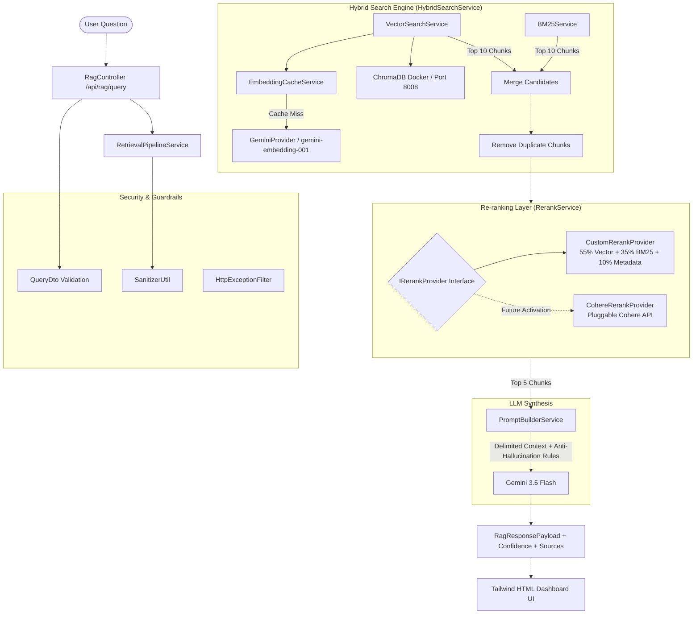

# 🚀 Production Hybrid Search RAG Engine

A production-grade, enterprise-ready **Hybrid Search Retrieval-Augmented Generation (RAG) System** built with **NestJS**, **Google Gemini 3.5 Flash**, **ChromaDB Vector Database**, **Okapi BM25 Keyword Search**, a **Multi-Factor Re-ranking Layer**, and a **Dockerized Developer Admin UI**.

---

## 🌟 Key Features

- **⚡ Hybrid Search Engine**: Combines **Semantic Vector Search (ChromaDB + Gemini Embeddings)** ($Top 10$) with **Okapi BM25 Keyword Search** ($Top 10$), merges candidates, and eliminates duplicates.
- **🎯 Multi-Factor Re-ranking Layer**: Custom scoring engine combining **Semantic Similarity** ($55\%$), **Keyword Overlap** ($35\%$), and **Metadata Quality** ($10\%$) to select the **Top 5 most relevant chunks**.
- **🔌 Pluggable Cohere Re-rank Interface**: Built using **Dependency Inversion** (`IRerankProvider`) for zero-downtime integration with Cohere Re-rank API via `COHERE_API_KEY`.
- **🛡️ Anti-Hallucination Prompt Guardrails**: Strict context boundaries (`<context></context>`) with conversational greeting support and automated fallbacks (`"I couldn't find this information in the uploaded knowledge base."`).
- **🔍 Visual ChromaDB Explorer & Admin UI**:
  - **In-App Explorer**: Built-in visual modal at `http://localhost:3000` to inspect vector chunks.
  - **Dedicated Developer Admin UI**: Independent Docker container running at `http://localhost:8001`.
- **📊 11-Step Pipeline Observability**: Clean, structured console logging tracing every retrieval stage.
- **🔒 Enterprise Security**: DTO validation (`class-validator`), input sanitization against prompt injection, and global HTTP exception filtering.
- **⚡ In-Memory Embedding Cache**: LRU cache preventing duplicate Google Gemini API calls.

---

## 🏛️ System Architecture



---

## 🛠️ Tech Stack

- **Backend Framework**: NestJS (TypeScript, Node.js)
- **LLM & Embeddings**: Google Generative AI (`gemini-3.5-flash` & `gemini-embedding-001`)
- **Vector Database**: ChromaDB (Dockerized)
- **Keyword Search**: Okapi BM25 Algorithm ($k_1=1.2, b=0.75$)
- **Containerization**: Docker & Docker Compose
- **Frontend**: HTML5, Tailwind CSS, Vanilla JavaScript
- **PDF Parser**: `pdf-parse`

---

## 🚀 Quick Start Guide

### Prerequisites
- **Node.js**: v18 or higher
- **Docker & Docker Compose**: Installed and running
- **Google Gemini API Key**: Obtainable from [Google AI Studio](https://aistudio.google.com/)

---

### Step 1: Clone & Install Dependencies

```powershell
# Navigate to the project root directory
cd d:\rag

# Install npm dependencies
npm install --legacy-peer-deps
```

---

### Step 2: Environment Configuration (`.env`)

Create or update `.env` in the root folder:

```env
PORT=3000
GEMINI_API_KEY=YOUR_ACTUAL_GEMINI_API_KEY
CHROMA_URL=http://127.0.0.1:8008
CHROMA_COLLECTION=hybrid_rag_collection
COHERE_API_KEY=
USE_COHERE_RERANK=false
```

---

### Step 3: Start ChromaDB & Admin UI via Docker

```powershell
# Start ChromaDB Server (Port 8008) and Developer Admin UI (Port 8001)
docker compose up -d --build
```

---

### Step 4: Start NestJS Backend Application

```powershell
# Development mode with hot-reloading
npm run start:dev

# Or build for production
npm run build
npm run start:prod
```

Now open **`http://localhost:3000`** in your browser!

---

## 🌐 Application Ports & Web Dashboards

| Service | Port / URL | Description |
| :--- | :--- | :--- |
| **Main Web Dashboard** | `http://localhost:3000` | Full Q&A Chat, PDF Ingestion & In-App Chroma Explorer Modal |
| **Developer Admin UI** | `http://localhost:8001` | Dedicated Docker Web GUI for deep database inspection |
| **ChromaDB Vector REST API** | `http://localhost:8008` | Dockerized ChromaDB vector database instance |

---

## 📡 API Reference

### 1. Ingest PDF Document
- **Endpoint**: `POST /api/rag/upload`
- **Content-Type**: `multipart/form-data`
- **Body**: `file: [PDF Document]`
- **Response**:
  ```json
  {
    "message": "PDF document successfully processed and indexed into Hybrid Search Engine.",
    "fileName": "resume.pdf",
    "totalChunksIndexed": 7
  }
  ```

### 2. Query Hybrid RAG System
- **Endpoint**: `POST /api/rag/query`
- **Content-Type**: `application/json`
- **Body**:
  ```json
  {
    "question": "What is the experience in Node.js?"
  }
  ```
- **Response**:
  ```json
  {
    "question": "What is the experience in Node.js?",
    "answer": "Senior Software Engineer with 4+ years of experience...",
    "confidence": "High",
    "maxScore": 0.7842,
    "sources": [
      {
        "id": "resume_pdf_chunk_0",
        "source": "resume.pdf",
        "chunkIndex": 0,
        "rerankScore": 0.7842
      }
    ],
    "pipelineSteps": [
      "[Step 1/11] Question Received...",
      "[Step 2/11] Generating Embedding...",
      "[Step 3/11] Running Vector Search (Top 10)...",
      "[Step 4/11] Running BM25 Search (Top 10)...",
      "[Step 5/11] Merging Results...",
      "[Step 6/11] Removing Duplicates...",
      "[Step 7/11] Re-ranking...",
      "[Step 8/11] Selecting Top 5...",
      "[Step 9/11] Sending Context to Gemini...",
      "[Step 10/11] Generating Final Response...",
      "[Step 11/11] Completed RAG Pipeline."
    ]
  }
  ```

### 3. Inspect ChromaDB Collection
- **Endpoint**: `GET /api/rag/collection`
- **Response**: Returns collection metadata and all stored text chunks.

### 4. Reset Knowledge Base
- **Endpoint**: `POST /api/rag/reset`
- **Response**: Clears ChromaDB vectors and BM25 index.

---

## 🧮 Hybrid Ranking & Re-ranking Formula

$$\text{Rerank Score} = 0.55 \times \text{Semantic Similarity} + 0.35 \times \text{Keyword Match} + 0.10 \times \text{Metadata Quality}$$

1. **Semantic Similarity ($55\%$)**: Cosine similarity score derived from Gemini vector embeddings ($3072D$).
2. **Keyword Match ($35\%$)**: Normalized Okapi BM25 score combined with query term coverage.
3. **Metadata Quality ($10\%$)**: Text density, sentence structure, and chunk position weighting.

---

## 📄 License
This project is licensed under the MIT License.
